<p align="center">
  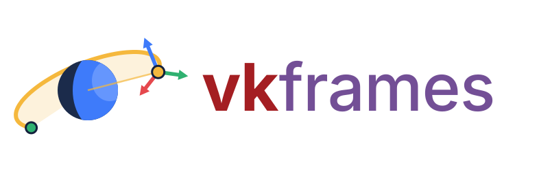
</p>

# vkframes

Spacecraft trajectory visualization for modern Fortran.

[](https://github.com/topics/fortran)
[](https://github.com/jacobwilliams/vkframes/actions)
[](https://jacobwilliams.github.io/vkframes/)

**vkFrames** is heavily inspired by [OpenFrames](https://github.com/ravidavi/OpenFrames), the [OpenSceneGraph](https://openscenegraph.github.io/openscenegraph.io/)-based
library used by tools such as NASA's GMAT and Copernicus. It has many of OpenFrames'
features, but an API designed for Fortran from the start: derived types with
type-bound procedures, double-precision arrays and optional arguments, and no
hidden global state. Vkframes is built on [VulkanSceneGraph](https://github.com/vsg-dev/VulkanSceneGraph) (VSG) and [Vulkan](https://www.vulkan.org/), providing high-performance, modern 3D graphics capabilities for Fortran applications.

> [!WARNING]
> **vkframes is highly experimental.** The API changes without notice, and
> some features are incomplete or missing. It has been used mainly on macOS.
> Linux is built and run only in CI, and Windows has had little testing (see
> [Platforms](#platforms)). Don't depend on it for anything important yet.

## Screenshots

<table>
  <tr>
    <td width="50%">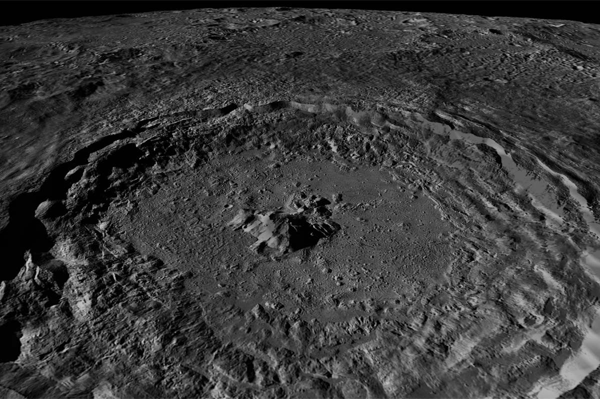</td>
    <td width="50%">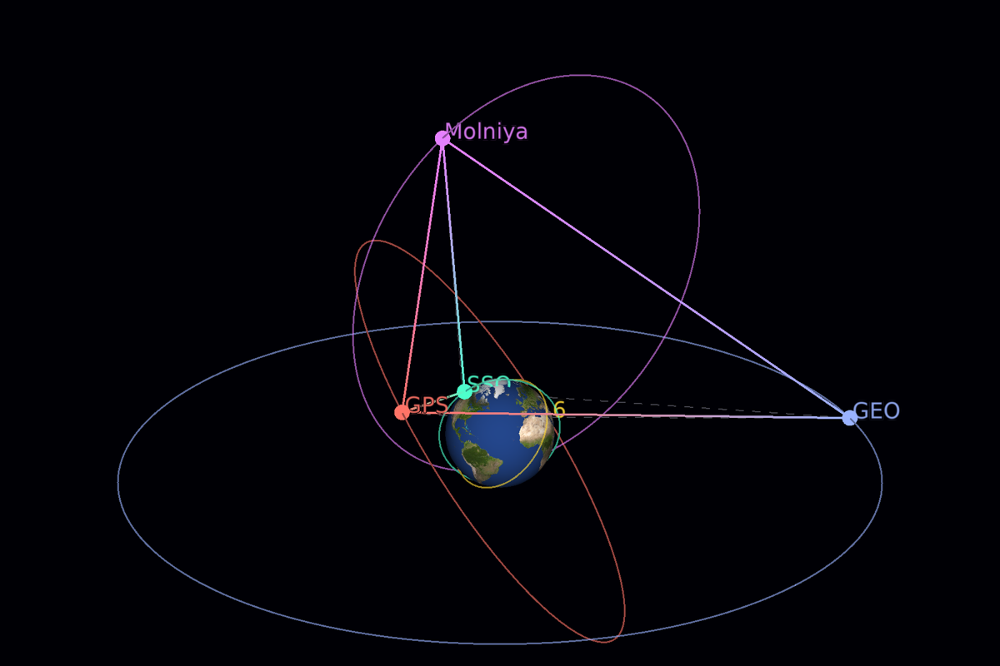</td>
  </tr>
  <tr>
    <td>Terrain through Rocky: Tycho crater, from LRO imagery and LOLA elevation (<code>rocky_map</code>).</td>
    <td>Lines of sight between spacecraft in five orbits, recomputed each frame (<code>line_of_sight</code>).</td>
  </tr>
  <tr>
    <td>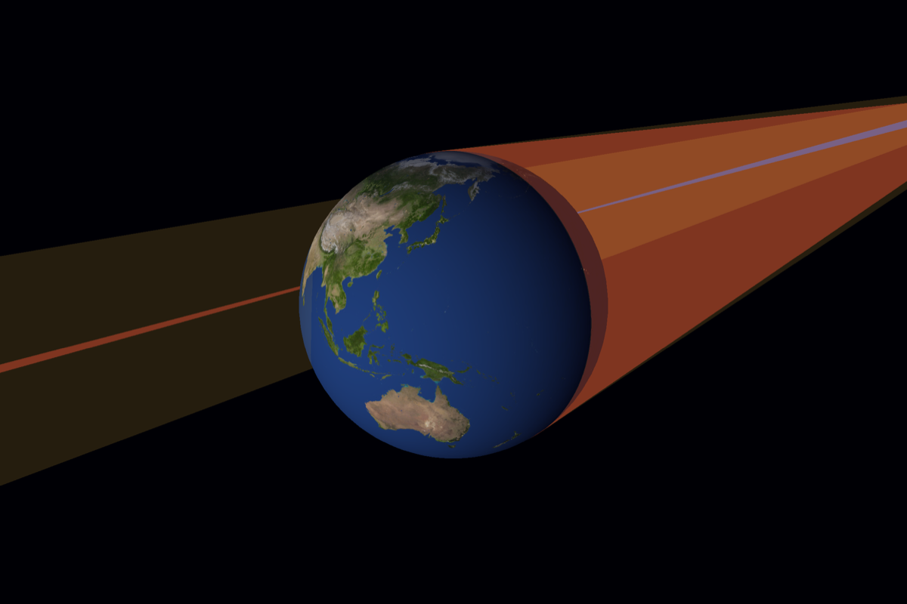</td>
    <td>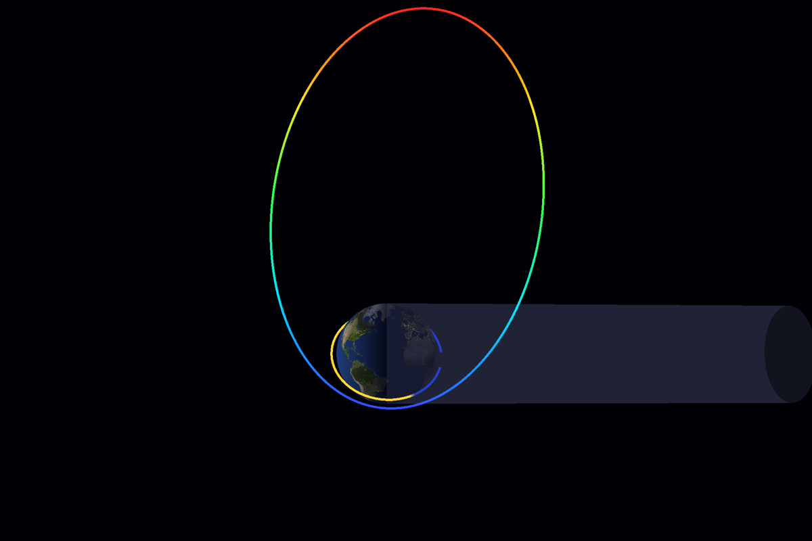</td>
  </tr>
  <tr>
    <td>Shadow cones in a solar eclipse: the Moon's umbra reaching the Earth inside its penumbra, and the Earth's own shadow behind it (<code>eclipse</code>).</td>
    <td>Colors per point: a Molniya orbit by altitude, a low orbit by sunlight, and the Earth's shadow (<code>colored_orbits</code>).</td>
  </tr>
  <tr>
    <td>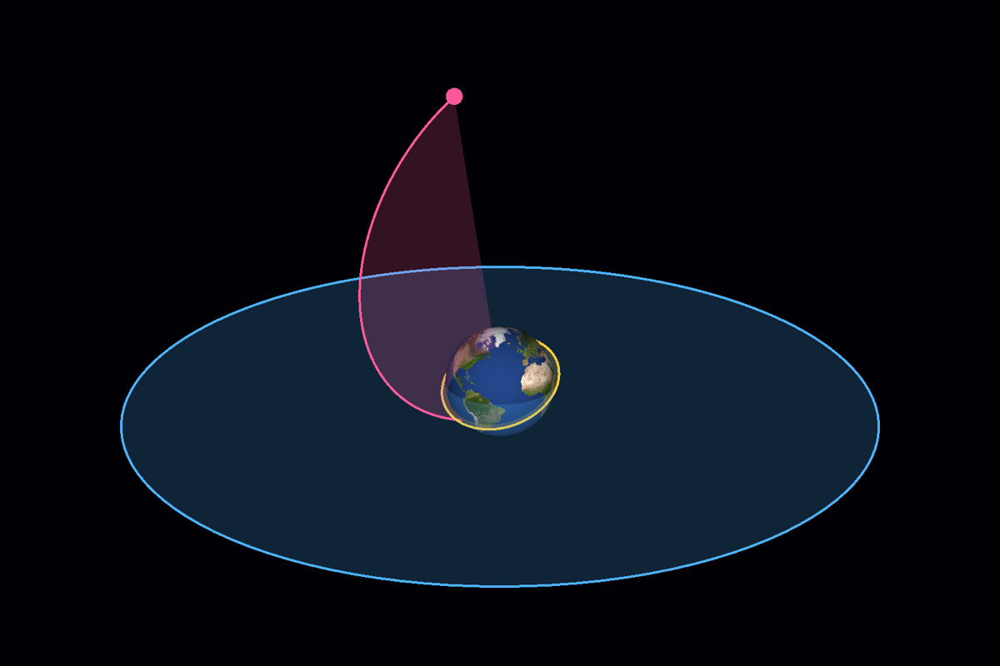</td>
    <td>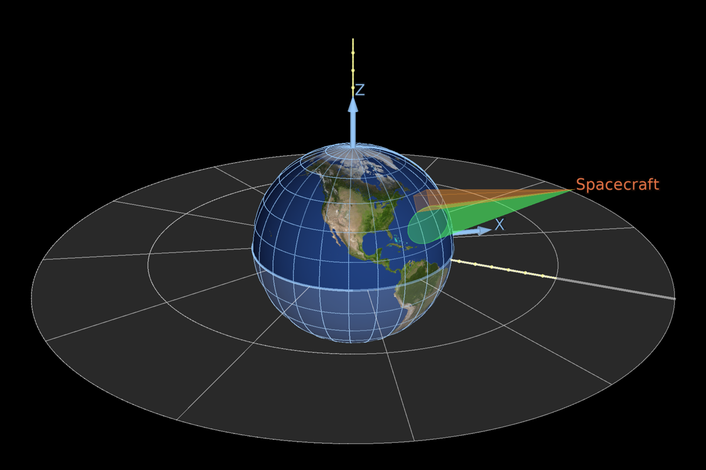</td>
  </tr>
  <tr>
    <td>Orbit planes swept from the Earth's center, one traced as its spacecraft moves (<code>orbit_planes</code>).</td>
    <td>Reference shapes: a latitude/longitude grid, a radial plane, axes with ticks and sensor cones (<code>shapes</code>).</td>
  </tr>
  <tr>
    <td>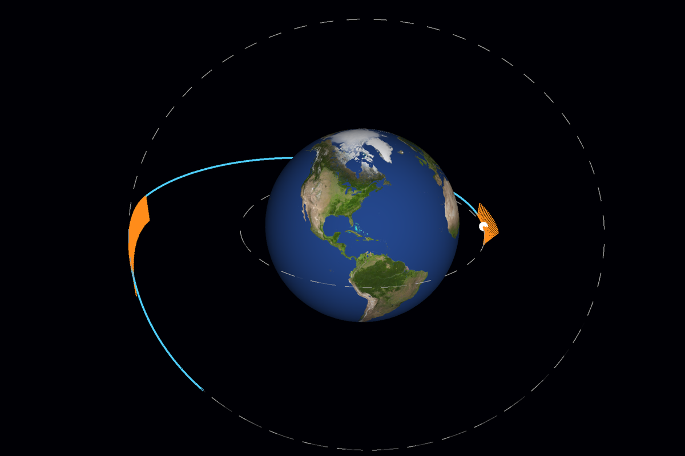</td>
    <td>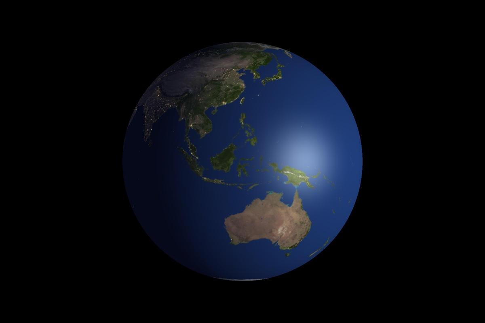</td>
  </tr>
  <tr>
    <td>Thrust vectors along an orbit transfer, drawn from each point at an adjustable scale (<code>thrust_arcs</code>).</td>
    <td>The Sun as a light source: the day texture, city lights on the night side and a specular glint (<code>day_night</code>).</td>
  </tr>
  <tr>
    <td>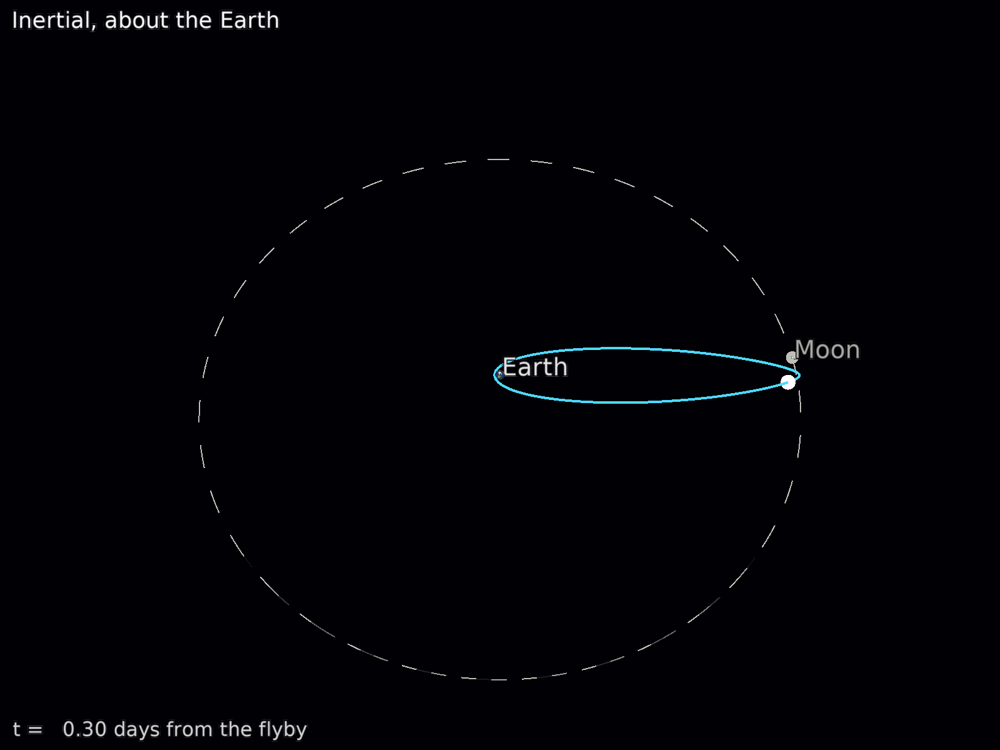</td>
    <td>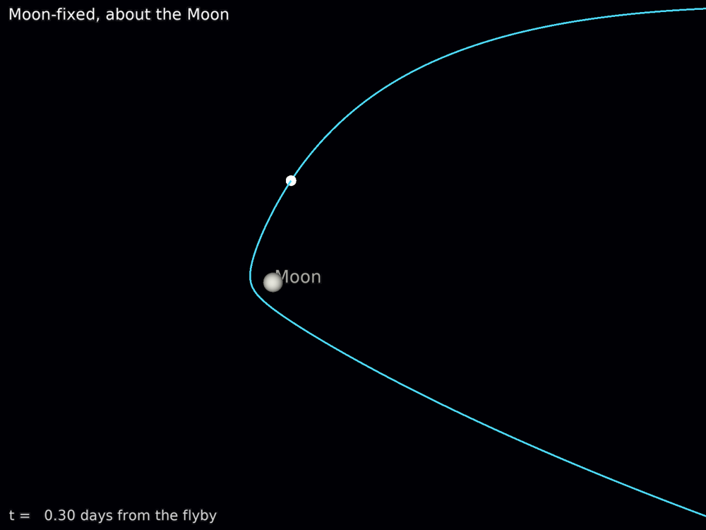</td>
  </tr>
  <tr>
    <td colspan="2">One trajectory in two frames, in two windows at the same moment: a free-return lunar flyby, inertial about the Earth (left) and Moon-fixed about the Moon (right) (<code>earth_moon_frames</code>).</td>
  </tr>
</table>

## Features

- **Reference frames**: a tree of frames with positions, attitudes
  (quaternions), axes, axis labels, name labels and colors. A `FrameManager`
  holds the scene.
- **Bodies**:
  - `Sphere`: a sphere or exact ellipsoid (such as WGS84) with day and night
    textures and a material. Its radius, color and material can change while
    it's shown. Level of detail keeps its outline smooth however close the
    view, with finer meshes only when needed. It can be translucent (not in
    OpenFrames; `set_opacity`): still lit, with what is behind it seen
    through it, e.g. a keep-out zone.
  - `Model`: a 3D model file (`.3ds`, `.obj`, glTF, OSG formats through
    vsgXchange).
- **Trajectories**:
  - `Trajectory`: time, position, attitude and optional data, with
    interpolation.
  - `TrajectoryFollower`: moves a frame along a trajectory (loop or limit;
    position and/or attitude).
- **Drawing trajectories**: a `DrawableTrajectory` holds artists, which can
  be added, changed and removed at run time. Only changed data is uploaded.
  - `CurveArtist`: thick lines with dash patterns, anchored to the line
    (the default: dashes stay put on it as the view changes), a fixed
    length of the line (`set_dash_mode(DASH_FIXED, length)`: as paint on
    it, never changing, so they grow on screen as you zoom in) or
    screen-locked
    (`set_dash_mode(DASH_SCREEN)`: every dash the same number of pixels at
    any zoom, as OpenGL's line stipple). A highlight (not in
    OpenFrames), for a trajectory selected by the program or picked: it
    pulses, and arrows move along it from its initial time to its final,
    animated by the GPU (`set_highlight`; also on `SegmentArtist`, and on a
    `DrawableTrajectory` for all its artists).
  - `SegmentArtist`: segments between data points. With relative ends (not
    in OpenFrames), a vector stored at each point, such as a thrust, is drawn
    from each position. Its length is a scale that can be changed at any
    time without touching the trajectory, and points with no vector draw
    nothing.
  - `MarkerArtist`: markers at the start, the end and in between, in
    OpenFrames' marker shapes, attenuated with distance by default
    (`set_auto_attenuate(.false.)` for a constant size). Optionally (not in
    OpenFrames; off by default, `set_point_colors`) each marker is drawn in
    the trajectory's point color there, blended between points.
  - Trace mode: draw only up to the current time: the points whose times
    have passed, whatever order they were added in, so a trajectory
    propagated backwards traces correctly as time runs forwards.
  - Fading trails (not in OpenFrames): only the part of a curve within a
    time window before and after the current time, each part fading toward
    its cutoff, with its own color, translucency and dash pattern (e.g. a
    solid past and a dashed future; `set_trail`, `set_trail_style`). Drawn
    and faded by the GPU: nothing but a few numbers is uploaded each frame.
  - Level of detail: seen from far away, a curve is drawn from fewer
    points, staying within half a pixel of all of them, chosen per view.
  - `RibbonArtist` (not in OpenFrames): a translucent surface swept out
    between two points at each trajectory point. By default it runs from the
    origin to the positions, filling in an orbit's plane. It's drawn whole,
    or in trace mode up to the spacecraft as it moves.
  - Point colors (not in OpenFrames): a trajectory can have a color for
    each point, and its curve is then drawn in them. Each segment blends
    from one point's color to the next, so runs of one color are solid and
    changes are smooth. Without colors, curves work as before.
- **Custom line segments**: `CustomLineSegments` (as OpenFrames') draws
  segments with a color at each end, set by the program or computed each
  frame by a callback: for example, lines of sight between spacecraft.
- **Reference shapes**: `CoordinateAxes` with tick marks, `LatLonGrid`,
  `RadialPlane`, and polyhedral, elliptic and rectangular cones.
- **Polyhedra and surfaces** (not in OpenFrames): `Polyhedron`, any shape
  fixed in its frame, from polygons (`set_faces`), triangles
  (`set_triangles`) or a grid of points (`set_grid`: e.g. a tube of
  trajectories), drawn as faces, edges and vertices. Faces are lit (flat or
  smooth) or unlit, in one color or a color per vertex, opaque or
  translucent, and one- or two-sided.
- **Shadow cones** (not in OpenFrames): `ShadowCones` shows a celestial
  body's shadow in the light of another (umbra, penumbra and antumbra) as
  transparent cones. They follow the body and are reshaped for its
  distance from the light as the bodies move. Turn them on or off per body.
- **Sky**: `SkySphere`, a star catalog (HYG v3) and/or a sky texture.
- **Lighting**: a frame can be a light source (such as the Sun), with
  ambient, diffuse and specular parts. Otherwise a headlight is used.
  - A body's night texture fades in where it's lit weakly, following its
    material and the light's intensity, as in OpenFrames but per pixel.
  - A twilight angle per body (not in OpenFrames) carries a little light past
    the terminator, as an atmosphere does. It's none by default.
- **Views and time**:
  - `View`: a trackball camera that follows a frame, or looks from one frame
    toward another. Perspective or orthographic.
  - The camera from a program: `get_camera` and `set_camera` (eye, center
    and up, in the view's frame or the root frame), as OpenFrames' trackball.
  - Smooth camera transitions (not in OpenFrames): changing the view, a
    reset, or `set_camera` with a duration flies the camera there instead
    of cutting, also between views following different frames.
  - `SimulationClock`: time scale, pause and set time. Clocks can be
    synchronized between windows.
- **Windows**:
  - `WindowProxy`: a VSG window of its own, or one embedded in a host GUI on
    its native handle.
  - Several windows can share one scene and one Vulkan device; a scene they
    share is updated once per simulation time.
  - Embedded windows handle resizing smoothly, Retina displays, and moving
    between screens of different scales.
  - Vsync by default; `vsync=.false.` renders as fast as possible (for
    measuring).
  - HUD text and screen capture to PNG.
  - Video recording (not in OpenFrames, which has only screenshots):
    `start_recording('orbit.mp4', fps=30)` ... `stop_recording()` pipes the
    frames drawn as raw pixels to ffmpeg (conda-forge's, in the pixi
    environment), which encodes them (H.264 by default; any ffmpeg encoder
    and options; a watermark such as a logo), with no image files. While
    recording, each frame advances the simulation time, camera flights and
    animations by exactly one frame's time, so the video is smooth at its
    own speed however long a frame takes to draw or encode.
  - Callouts: HUD text and frames' labels can change while shown (text,
    color, position, size, alignment, font). A frame's name label can be
    drawn on top of the scene, so a frame moved to a picked point makes a
    readout that follows it; `screen_position` gives where a point is on the
    screen, to keep HUD text next to a moving object. The event handler's
    `before_draw` is called each frame once the scene and camera are final,
    so such a callout is in step with what is drawn.
  - GUI panels (not in OpenFrames): Dear ImGui panels with text, buttons,
    checkboxes and sliders, drawn flat on top of the scene in vkframes' own
    windows (and embedded ones), described from Fortran each frame
    (`window%gui()`). A panel can stay next to a picked or moving object.
    Clicks over a panel go to it, not to the camera or picking.
  - Picking (not in OpenFrames): `pick(x, y, hits)` gives what is under a
    point of the window, nearest first: a trajectory's curve (the point and
    the time there, interpolated), its markers and segments, a body (the
    point on its surface, with latitude and longitude) or a frame. Lines and
    markers are reached within a few pixels beyond their width or size; in
    trace mode only what is drawn is picked. Frames and artists can be left
    out (`set_pickable`), a pick can ask for some kinds only, and for the
    nearest hit only (cheap enough for every mouse move).
  - Keyboard and mouse: a program's `WindowEventHandler` (OpenFrames' window
    callbacks) is given key presses and releases, mouse motion and button
    presses and releases, also in embedded windows. OpenFrames' keys are
    built in: `v` and `V` for the next and previous view, the space bar to
    reset the view. The mouse's zoom speed (`set_zoom_speed`, per wheel or
    trackpad step and per right drag) and whether the camera keeps moving
    after a released drag (`set_camera_throw`) can be set.
- **Precision**: double precision throughout. Lines are drawn relative to the
  eye and the depth buffer uses reverse-Z, so a 10 m spacecraft and an Earth
  orbit can share one view without OpenFrames' `DepthPartitioner`.
- **Maps and terrain** (optional, through
  [Rocky](https://github.com/pelicanmapping/rocky)): `TerrainBody`, a body
  with imagery and elevation layers (tile services or GeoTIFF), lit by the
  scene's lights. It can query terrain elevation. Earth and Moon profiles are
  available.
- **GUI embedding**: in Fortran Qt GUIs through
  [qt-fortran](https://github.com/jacobwilliams/qt-fortran), and in Python
  through [PySide6](https://www.qt.io/development/qt-framework/python-bindings).

Not done yet: shadows cast on bodies (darkening them), sensor visibility and
video recording.
[plans/plan.md](plans/plan.md) has the full feature map and what is still
open.

## How it is built

- **Mostly Fortran.** The scene tree, trajectories and interpolation,
  following, time, cameras and all geometry (orbit points, ellipsoids,
  grids, cones, axes) are written in Fortran (`src/*.f90`).
- **A thin C++ layer** (`src/vsg/`) wraps VSG behind opaque handles and
  `bind(C)` interfaces. It covers nodes, pipelines, textures, model loading,
  windows and the frame loop, and knows nothing about spacecraft.
- **GLSL shaders** for lines, markers, stars, sky and labels
  (`shaders/`) are compiled to SPIR-V at build time and embedded in the
  library.
- **Everything runs on one thread** (the GUI thread). Vulkan has no current
  context, so there is no render thread and none of OpenGL's macOS
  workarounds.

### How it is developed

- vkframes is developed by Jacob Williams with AI assistance (Anthropic's
  Claude, through Claude Code). Most commits are co-authored with it.
- OpenFrames' headers are the reference for features and algorithms. Its C
  and Fortran interface is not the reference for the API.
- The design, decisions and remaining work are tracked in
  [plans/plan.md](plans/plan.md).
- All tools and dependencies come from conda-forge through
  [pixi](https://pixi.sh). The build uses [fpm](https://fpm.fortran-lang.org)
  (the Fortran Package Manager).
- CI (`.github/workflows/ci.yml`) builds on Ubuntu, macOS and Windows. It
  runs tests, renders examples on Linux with Mesa's software Vulkan driver,
  and builds the Qt demo.

## Dependencies

All of these are installed by pixi (see [pixi.toml](pixi.toml)):

| | |
|---|---|
| Fortran | gfortran 15, fpm 0.13 |
| C++ | a C++ compiler (clang++ on Windows, for conda-forge's MSVC-built VSG), CMake, Ninja |
| Rendering | VulkanSceneGraph 1.1, vsgXchange 1.1 (images, models, fonts), glslang (shader compiler) |
| GUI panels | vsgImGui 0.8 (Dear ImGui 1.92) |
| Vulkan on macOS | [KosmicKrisp](https://docs.mesa3d.org/drivers/kosmickrisp.html) (Mesa's Vulkan on Metal) |
| Fonts | DejaVu Sans (the default label font) |
| Video recording | [ffmpeg](https://www.ffmpeg.org) (run as a program; not linked) |
| Qt demos (`qt` environment) | Qt 6.11; qt-fortran and json-fortran are fetched by fpm |
| Python demo | Python 3.13, PySide6 |
| Rocky (`rocky` environment) | GDAL, PROJ, spdlog, glm, entt and others; Rocky itself is built from source |

## Platforms

| Platform | Status |
|---|---|
| macOS (Apple silicon, macOS 26 or later) | The main development platform. KosmicKrisp needs Metal 4, so Intel Macs and older macOS aren't supported. |
| Windows (x64) | Builds and runs (the C++ layer is a DLL built with clang++), but has had less testing. |
| Linux (x64) | Built and run in CI only, with software Vulkan (lavapipe) under Xvfb. Not tested on real GPUs or with the Qt demos on a desktop. |

Rocky has only been tried on macOS.

## Getting started

Install [pixi](https://pixi.sh), then from the repository's root:

```sh
pixi run build      # the library, the examples and the tests
pixi run test       # all tests (test_vulkan and others need a Vulkan device)
pixi run test test_geometry    # one test
```

Builds go through `tools/fpm_vsg.py`, which gives fpm the C++ compiler, the
VSG flags and the libraries to link, compiles the shaders, and puts
`data/` on `VKFRAMES_DATA_PATH`. Run fpm through these tasks rather than
directly.

If fpm reports odd errors or crashes after you pull changes that alter
derived types, remove its stale objects with `rm -rf build/gfortran_*` and
build again.

### Examples

The examples in [example/](example/) are short programs, each in a window
of its own (no GUI toolkit). Each shows one part of the API:

| Example | Screenshot | What it shows |
|---|---|---|
| `hello_sphere` | 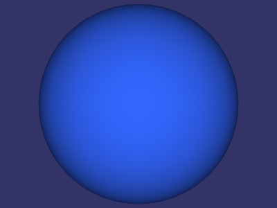 | The smallest program: a window with a sphere, the trackball, and the frame loop driven from Fortran. |
| `orbit_demo` | 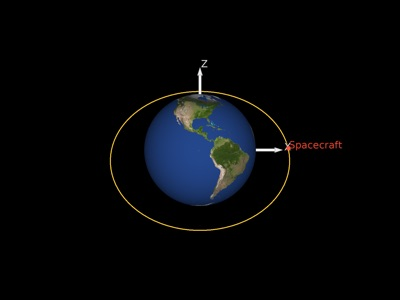 | The program in [A small program](#a-small-program): a textured Earth, a spacecraft following an inclined circular orbit, and the orbit drawn as a line (`Trajectory`, `CurveArtist`). |
| `orbit` | 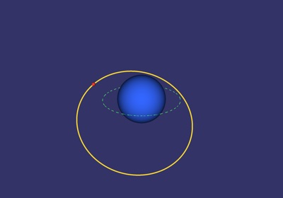 | An inclined elliptical orbit drawn as a thick line (`CurveArtist`), a dashed equator, and a spacecraft moved along the orbit by Fortran each frame (Kepler's equation). |
| `earth` | 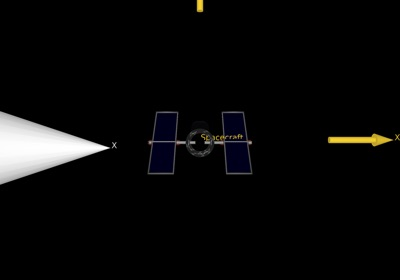 | A textured WGS84 Earth and a 3D model following an orbit (`Model`, `Trajectory`, `TrajectoryFollower`), with three views: of the Earth, of the spacecraft, and from the spacecraft toward the Earth. Needs a texture and a model file. |
| `day_night` | 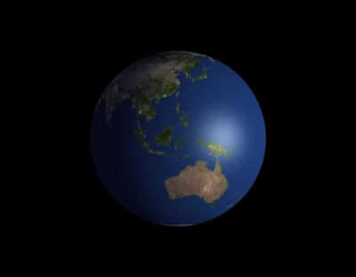 | Lighting: the Sun as a light source an astronomical unit away, day and night textures (city lights on the night side), and a specular glint from the sphere's material. |
| `shapes` | 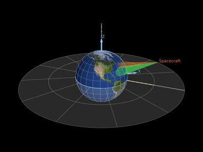 | The reference shapes: coordinate axes with tick marks, a latitude/longitude grid, an equatorial plane and sensor cones pointed at the Earth. |
| `two_windows` | 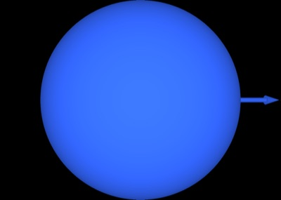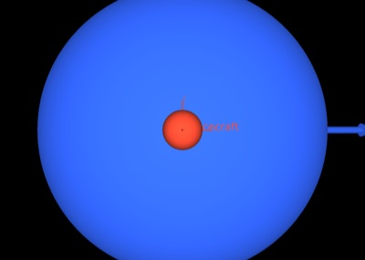 | One scene in two windows, each with its own view, their clocks synchronized so both show the same time. |
| `pick_trajectories` | 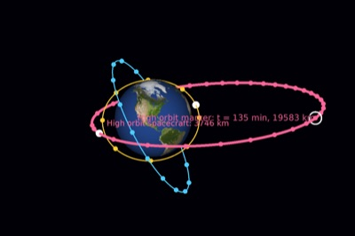 | Picking and callouts: three orbits with markers; the orbit under the pointer is drawn thicker, a click selects an orbit or marker (a ring and a readout at the point: the time there and the altitude) or the Earth (latitude and longitude), a GUI panel follows the selected orbit's spacecraft (its altitude, trace mode, line width, go to the time picked), a Controls panel sets the time scale and pause, and `g` goes to the time selected. |
| `highlight_trajectory` | 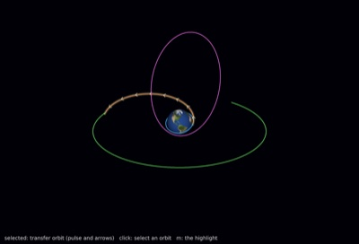 | Highlighting a selected trajectory: four Earth orbits (parking, transfer, geostationary, Molniya); the program selects the next every few seconds and a click selects the one under the pointer. The selected orbit pulses, with arrows moving along it from its initial time to its final in a translucent band (`set_highlight`, animated by the GPU); `m` changes the highlight's mode. |
| `record_video` | 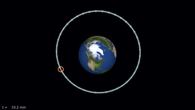 | Recording a video: a spacecraft on a highlighted orbit with a pulsing marker, the Earth spinning with its axes and a latitude/longitude grid, and a camera flight half way, recorded to a video file by ffmpeg (`start_recording`, `stop_recording`), with the vkframes logo as a translucent watermark; the simulation time, the flight and the animations advance by exactly one frame's time per frame, so the video is smooth however fast the window draws. |
| `camera_tour` | 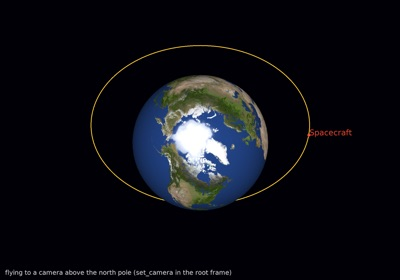 | The camera from a program: a scripted tour that flies between an Earth view and one following a spacecraft (a view transition), and to cameras given in the root frame (`set_camera` with a duration), printing where the camera is (`get_camera`). |
| `earth_moon_frames` | 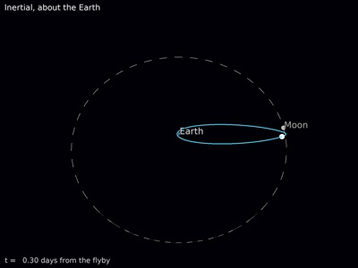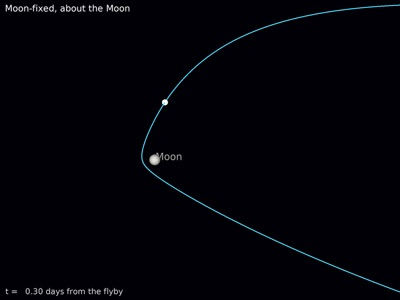 | One trajectory in two frames at once: a free-return lunar flyby shown in inertial coordinates about the Earth in one window, and in the Moon's body-fixed frame about the Moon in the other. Each window has its own scene; the Moon-fixed copy is transformed in Fortran, each point at its own time. |
| `live_changes` | 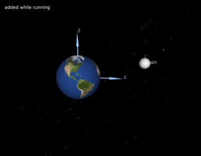 | Changing a scene while it's shown: a Moon added and removed, the Earth's axes moved, HUD text and a starry sky added. |
| `precision` | 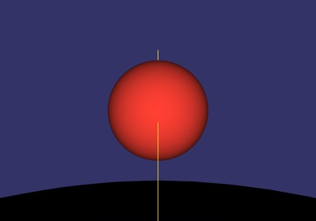 | Double precision: a 10 m spacecraft on a 7000 km orbit line, seen from 30 m away; the line passes through the spacecraft's center (in plain float it would be off by about a meter). |
| `line_of_sight` | 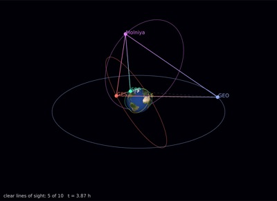 | `CustomLineSegments`: five spacecraft in different orbits (LEO, sun-synchronous, GPS, GEO, Molniya), shown as markers, with a line of sight between every pair, recomputed each frame by a callback: clear links in the spacecraft's colors, links the Earth blocks dashed. |
| `colored_orbits` | 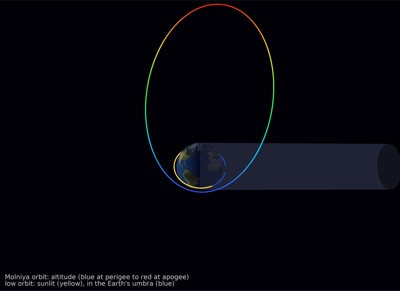 | A color per trajectory point: a Molniya orbit colored by altitude (a smooth gradient), and a traced low orbit colored by sunlight (yellow while sunlit, blue in the Earth's umbra, matching the Earth's `ShadowCones`). |
| `orbit_planes` | 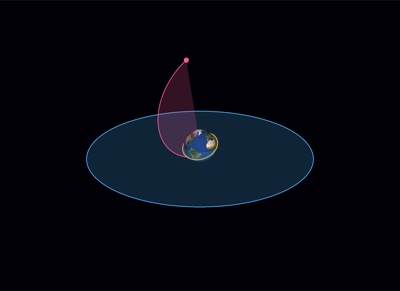 | `RibbonArtist`: orbit planes swept out from the Earth's center, for a low orbit and a geostationary orbit drawn whole, and a Molniya orbit traced as its spacecraft moves. |
| `trace_directions` | 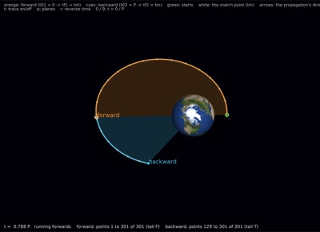 | Trace mode with trajectories propagated forwards and backwards: one orbit split at a match point (forward from t01 to tm, backward from t02 to tm, the same state there). As time runs the two trace one continuous history, each sweeping out its orbit's plane (`RibbonArtist`); arrows show each one's propagation direction. Keys reverse the time and toggle trace mode and the planes. |
| `fading_trails` | 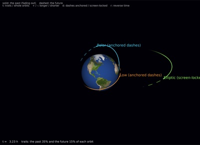 | Fading trails: three spacecraft drawn only near the current time, a solid trail behind each (fading out) and a dashed, translucent one ahead (`set_trail`, `set_trail_style`). Each orbit has one of the three dash layouts (`set_dash_mode`: anchored, fixed-length, screen-locked), to compare; keys toggle the whole orbits, lengthen or shorten the trails, and rotate the dash layouts. |
| `thrust_arcs` | 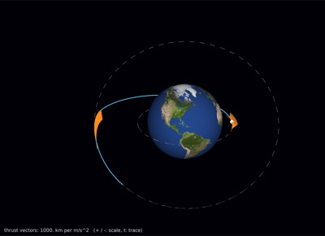 | Thrust vectors along a transfer between two circular orbits, with a burn at the start and another at the apoapsis that also changes the plane (`SegmentArtist` with relative ends). The orbit is orange while thrusting, and `+` and `-` change the vectors' scale (a `WindowEventHandler`). |
| `eclipse` | 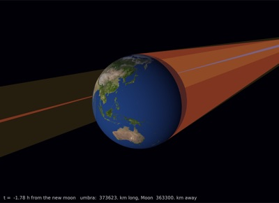 | `ShadowCones`: a total solar eclipse. The Earth orbits the Sun and the Moon orbits the Earth, and the Moon's umbra reaches the Earth inside its wide penumbra. The Earth's own shadow points away from the Sun. A HUD line shows the umbra's length. |
| `rocky_map` | 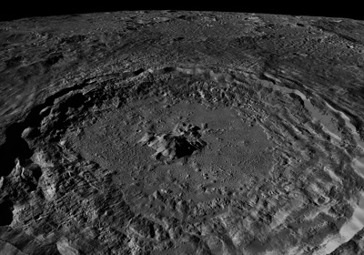 | Terrain with Rocky (`TerrainBody`; needs the `rocky` environment): the Earth from ReadyMap's tiles, or the Moon from NASA's Moon Trek and LOLA's elevation, from orbit and close to the surface. |

```sh
pixi run example hello_sphere
pixi run example orbit_demo
pixi run example orbit
pixi run example earth -- texture.jpg model.3ds     # e.g. OpenFrames' Demos/Images and Demos/Models/Hubble.3ds
pixi run example day_night
pixi run example shapes
pixi run example two_windows
pixi run example earth_moon_frames
pixi run example camera_tour
pixi run example pick_trajectories
pixi run example highlight_trajectory
pixi run example record_video -- orbit.mp4 8          # an 8 s video
pixi run example trace_directions
pixi run example fading_trails
pixi run example live_changes
pixi run example precision
pixi run example line_of_sight
pixi run example eclipse
pixi run example colored_orbits
pixi run example orbit_planes
pixi run example thrust_arcs
pixi run -e rocky example rocky_map -- moon         # or: earth (after the Rocky build, see the lunar demo)
```

Most examples take an optional frame count and an image file to capture,
for example `pixi run example orbit -- 300 orbit.png`; without them they
run until the window is closed. The comment at the top of each file lists
its arguments.

### Demos

Each demo in [demos/](demos/) is a fuller application with a GUI, and a
separate fpm project that depends on vkframes (the library itself doesn't
depend on Qt or Python). They run vkframes embedded in a host window: the
GUI toolkit owns the window and forwards its events, and vkframes renders
into it.

#### Qt demo

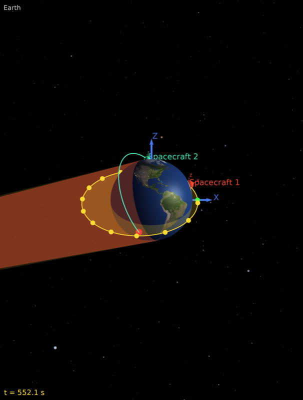

[demos/qt](demos/qt): a spacecraft orbiting the Earth in a
[qt-fortran](https://github.com/jacobwilliams/qt-fortran) main window, next
to a dock of controls. It's the most complete demo, and it shows most of the
library:

- **Scene:** the WGS84 Earth with day and night textures, rotating; a
  spacecraft (OpenFrames' Hubble model, or a sphere) and a second spacecraft
  on part of another orbit; the Sun as a light source; a starry sky.
- **Trajectories:** the orbits drawn whole or traced up to the spacecraft,
  in a dash pattern (its dashes anchored to the line, fixed-length or screen-locked), or
  colored by altitude (a color per point); the orbit's
  plane swept out (`RibbonArtist`); markers along them; radius vectors (a `SegmentArtist`)
  added and removed while running.
- **The spacecraft as markers:** shown as their bodies, or as a marker of
  any shape at their current positions.
- **Line of sight:** between the two spacecraft (`CustomLineSegments`),
  green while clear of the Earth, red when it's blocked.
- **Reference shapes:** a latitude/longitude grid, coordinate axes with tick
  marks, the equatorial plane, a sensor cone.
- **The Earth's shadow:** its umbra and penumbra (`ShadowCones`), pointing
  away from the Sun; the orbit passes through it.
- **Views and time:** six views (of the Earth, of each spacecraft, and from
  each spacecraft toward the Earth or the other); a time scale, pause and a
  time slider.
- **Picking:** a click picks what is under it: an orbit or marker (the
  frame, the time there and the altitude; `g` goes to that time) or the Earth
  (latitude and longitude), shown in the dock and in a GUI panel at the
  point (with a button to go to that time). An orbit picked is highlighted
  (it pulses, with arrows moving along it).
- **Camera:** changing the view flies the camera there (the time is set in
  the dock; 0 s cuts, as OpenFrames).
- **Video:** Record video... records the main window to a video file
  (ffmpeg), until Stop recording.
- **Keys and mouse:** a `WindowEventHandler` per window: `v` and `V` change
  the view (the view menu follows), `p` pauses the time, the space bar resets
  the view; the pointer's position and the last click are shown in the dock.
- **Windows:** up to four, each with its own view, their clocks synchronized
  to the main window's; resizing, Retina displays and moving between screens
  of different scales are handled.

```sh
pixi run -e qt qt-demo
pixi run -e qt qt-demo -- --windows 2 --shapes --los --shadow --position-marker 6
```

Options include `--view n`, `--windows n`, `--trace`, `--altitude-colors`,
`--plane`, `--radius`,
`--marker n`, `--position-marker n`, `--sky n`, `--shapes`, `--los`,
`--shadow`,
`--pattern n`, `--capture file` and `--quit-after seconds`; the comment at
the top of [demos/qt/app/main.f90](demos/qt/app/main.f90) explains them. To
use OpenFrames' Hubble model and star map, point `OPENFRAMES_DATA` (or
`--data`) at OpenFrames' `Demos` folder.

#### Trajectory file demo

[demos/trajectory](demos/trajectory): trajectory data from a file, with a
style editor. It reads segments (times and positions) from a JSON file with
[json-fortran](https://github.com/jacobwilliams/json-fortran), and draws
each as a trajectory: a curve, markers, and a body following it, around the
central body named in the file.

- A dock editor shows each segment's style: line color, width and dash
  pattern; markers (start, end, at an interval or every n points, shape,
  size, colors); the body (radius, color); visibility, trace and label.
- Every change is drawn at once.
- File > Save / Save As write the file back with the new styles (the data
  and any other keys are kept).

```sh
pixi run -e qt trajectory-demo                      # data/trajectory.json
pixi run -e qt trajectory-demo -- my_segments.json
```

The file format and every style option are documented at the top of
[demos/trajectory/app/main.f90](demos/trajectory/app/main.f90).

#### CR3BP demo

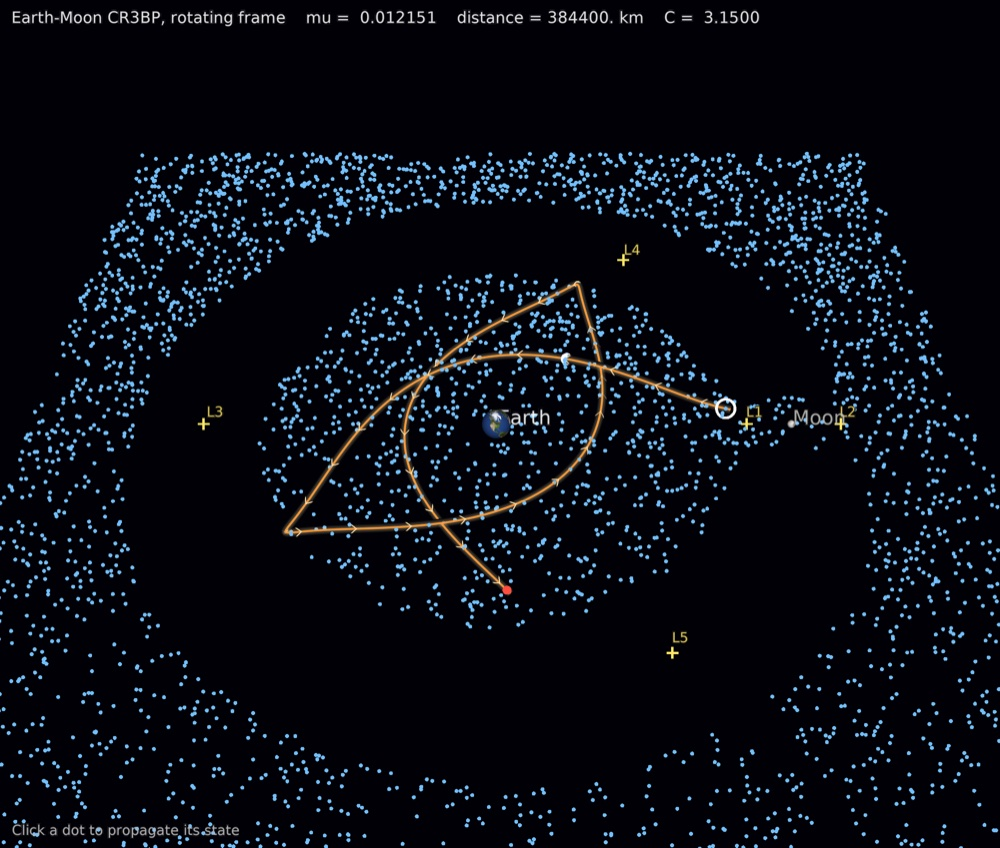

[demos/cr3bp](demos/cr3bp): the Earth-Moon circular restricted three-body
problem, in the frame rotating with the Earth and the Moon (both fixed).

- A cloud of states of one Jacobi constant, drawn as dots (one marker per
  state of a trajectory that is never drawn as a line). The cloud fills the
  region that constant allows, inside its zero-velocity curves; the
  Lagrange points are marked.
- Click a dot: its state is propagated with the CR3BP equations of motion
  (an adaptive Dormand-Prince 5(4) integrator in Fortran, stopping at an
  impact), drawn as a highlighted curve with arrows in the direction of
  time, and optionally flown by a spacecraft.
- The dock sets the Earth-Moon distance, the mass ratio, the Jacobi
  constant (with the Lagrange points' constants), the number of states,
  planar or 3D, the random seed, the propagation time (forwards or
  backwards), and the bodies' drawn size. The readout shows the state, how
  the propagation ended and the Jacobi constant's drift.
- Color by: all blue, or each dot by its state's fate after the propagation
  time (hits the Earth, hits the Moon, escapes beyond a distance, or
  neither), with a legend counting each: every state is propagated (in
  parallel, with OpenMP), and the dots are drawn in per-marker colors
  (`MarkerArtist%set_point_colors`).
- `e` and `m` (or the dock's buttons) fly the camera to the Earth and the
  Moon, which it then turns about; the space bar resets the view.

```sh
pixi run -e qt cr3bp-demo
```

#### Halo manifolds demo

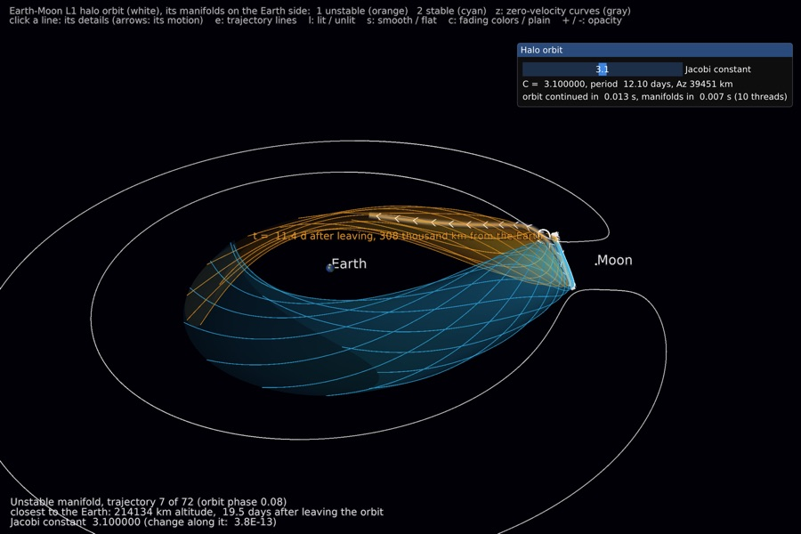

[demos/halo](demos/halo): an Earth-Moon L1 halo orbit (CR3BP, rotating
frame) and its invariant manifolds on the Earth's side.

- The halo orbit by differential correction; its manifolds from the
  monodromy matrix's eigenvectors, carried around the orbit by the state
  transition matrix: the unstable (leaving) and stable (arriving) tubes,
  each a translucent, lit `Polyhedron` grid of 72 trajectories fading along
  time; the zero-velocity curves at its Jacobi constant (a `Polyhedron` of
  edges only).
- Click a trajectory line: it's highlighted (pulsing, arrows in its
  direction of motion), with a readout at the point clicked and its details
  (its place around the orbit, its closest approach to the Earth, its
  Jacobi constant's drift).
- A GUI slider picks the Jacobi constant: another orbit of the family (by
  continuation), its manifolds computed again, in parallel with OpenMP, as
  the slider moves.
- Keys toggle each tube, the curves, the trajectory lines, lighting,
  smoothing, the fading colors and the opacity.

```sh
pixi run halo-demo
```

#### Rendezvous demo

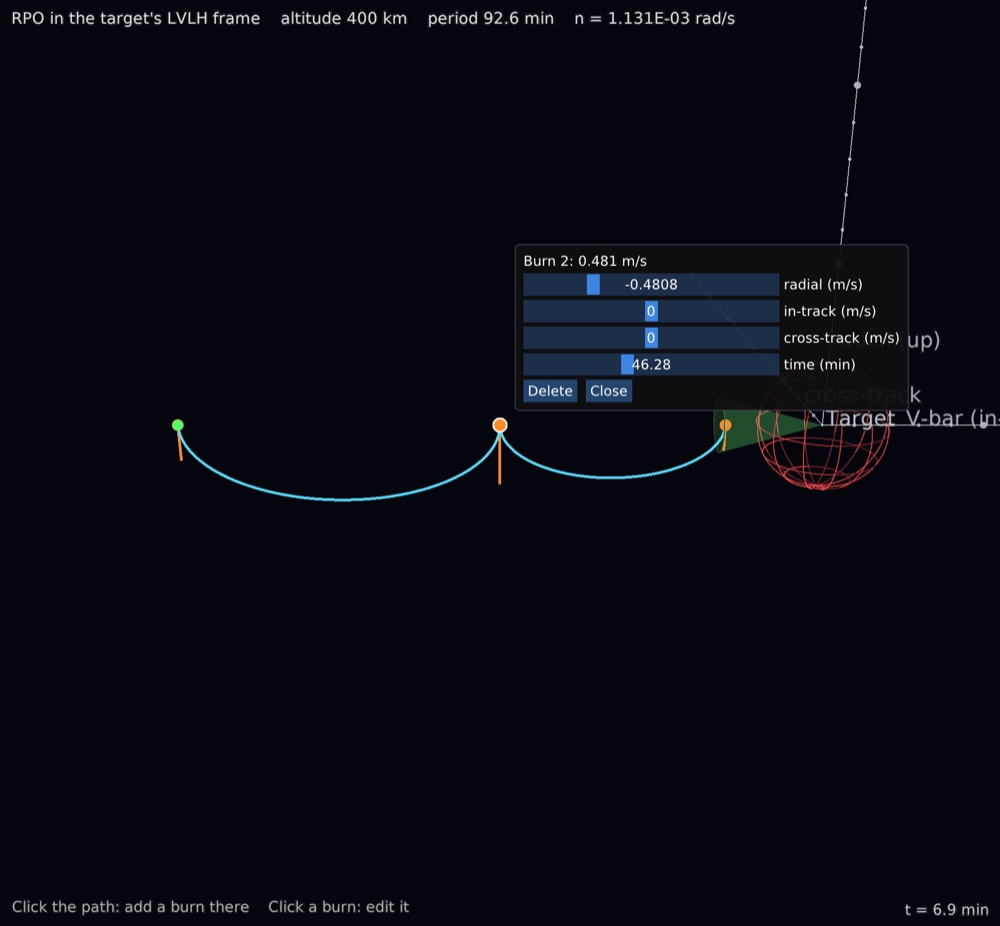

[demos/rpo](demos/rpo): rendezvous and proximity operations, in the
target's LVLH frame (V-bar, cross-track, radial), under the
Clohessy-Wiltshire equations (closed form, in Fortran).

- A plan, the chaser's start and impulsive burns, drawn as a path colored by
  safety: outside the keep-out sphere, inside it within the approach
  corridor, or inside it outside the corridor (a violation). The keep-out
  sphere is a translucent sphere, the corridor a translucent cone, the burns
  markers with their Δv as vectors.
- Click the path: a burn is added there. Click a burn: a panel next to it
  sets its Δv and time (or deletes it), and the path is propagated again as
  the sliders move.
- Presets (radial hops along V-bar, a natural-motion circumnavigation, a
  drift from below, a football too close); the target's altitude, the
  duration, the start, the keep-out radius and corridor angle in the dock,
  with the total Δv, the closest approach and any violation. Animation, a
  view following the chaser, and video recording.

```sh
pixi run -e qt rpo-demo
```

#### PySide6 demo

[demos/pyside6](demos/pyside6): the same kind of scene in a Python GUI
(PySide6). It shows how to use vkframes from Python:

- The scene and its windows are Fortran, built as a shared library with a
  small C interface of the demo's own.
- The Python GUI loads that library with ctypes, owns the Qt windows, and
  forwards their events.
- Record video... records the main window to a video file (ffmpeg).
- One or more windows can be opened, with a choice of view and sky.

```sh
pixi run pyside6-demo
pixi run pyside6-demo -- --windows 2 --trace
```

Options (`--view n`, `--windows n`, `--sky n`, `--trace`, `--capture file`,
`--quit-after seconds`) are listed at the top of
[demos/pyside6/app.py](demos/pyside6/app.py).

#### Lunar demo

[demos/moon](demos/moon): terrain with Rocky, in a qt-fortran GUI:

- **Terrain:** the Moon's surface from LRO imagery (NASA's Moon Trek, over
  the network) and LOLA's elevation, lit by the Sun, under a starry sky.
- **Spacecraft:** one in a 100 km polar orbit over Tycho crater; and a
  lander in the same orbit that descends and lands on Tycho's floor, at the
  terrain's height there.
- **Views:** seven, including Tycho close to the surface, and the lander
  seen from the landing site as it comes down.
- **Dock:** the time, the Sun's longitude (low Sun, long shadows), the
  terrain's lighting, and the curves.

It needs the `rocky` environment and a one-time Rocky build:

```sh
pixi run -e rocky rocky-build     # once: builds Rocky from source into the environment
pixi run -e rocky moon-data       # once: downloads LOLA's elevation (33 MB) into data/
pixi run -e rocky moon-demo
pixi run -e rocky moon-demo -- --view 6 --sun 60
```

Options (`--view n`, `--sun degrees`, `--time seconds`, `--capture file`,
`--quit-after seconds`) are at the top of
[demos/moon/app/main.f90](demos/moon/app/main.f90).

### Benchmark against OpenFrames

[bench/](bench/README.md) has two qt-fortran apps that draw the same scene,
one with vkframes and one with stock OpenFrames, in two scenarios: a large
static trajectory, and a growing one. On macOS, vkframes draws 10 to 22
times as many frames as OpenFrames at 1 and 5 million points; the results
and how they were measured are in [bench/README.md](bench/README.md), and
the comparison of the two libraries in
[plans/openframes-compare.md](plans/openframes-compare.md).

```sh
pixi run -e openframes openframes-build    # once
pixi run bench
```

## A small program

The Earth, a spacecraft following an inclined circular orbit, and the orbit
drawn as a line ([example/orbit_demo.f90](example/orbit_demo.f90):
`pixi run example orbit_demo`):

<p align="center">
  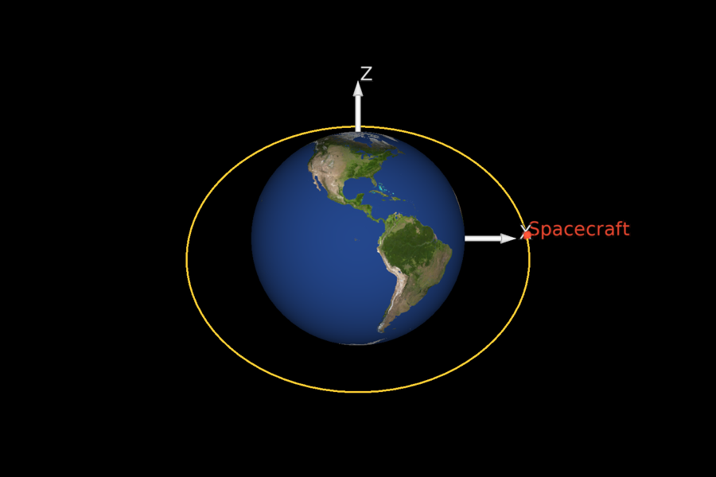
</p>

```fortran
program orbit_demo
    use vkframes
    implicit none
    real(wp), parameter :: re = 6378.137_wp, inc = 50.0_wp * pi / 180.0_wp
    type(Sphere), target :: earth, craft
    type(Trajectory), target :: orbit
    type(DrawableTrajectory), target :: orbit_frame
    type(CurveArtist), target :: orbit_line
    type(FrameManager), target :: scene
    type(WindowProxy), target :: window
    type(View), target :: earth_view
    real(wp) :: t, a
    integer :: k

    earth = Sphere('Earth', radius=re)
    call earth%set_texture_map('2k_earth_daymap.jpg')   ! (in data/, found on VKFRAMES_DATA_PATH)
    craft = Sphere('Spacecraft', radius=300.0_wp, color=[1.0_wp, 0.3_wp, 0.2_wp])

    ! a circular orbit inclined 50 degrees, sampled over one period (600 s here)
    orbit = Trajectory()
    do k = 0, 360
        t = 600.0_wp * k / 360.0_wp
        a = 2.0_wp * pi * t / 600.0_wp
        call orbit%add(t, pos=1.6_wp * re * [cos(a), sin(a) * cos(inc), sin(a) * sin(inc)])
    end do
    call craft%follow(orbit)

    ! the orbit drawn as a line
    orbit_line = CurveArtist(orbit, color=[1.0_wp, 0.8_wp, 0.2_wp], width=2.0_wp)
    orbit_frame = DrawableTrajectory('Orbit')
    call orbit_frame%add_artist(orbit_line)
    if (.not. (earth%add_child(craft) .and. earth%add_child(orbit_frame))) error stop 'add_child failed'
    scene = FrameManager(earth)

    if (.not. window%open(800, 600, 'vkframes')) error stop 'could not open a window'
    call window%set_scene(scene)
    earth_view = View(earth, earth)
    call earth_view%set_default_view_distance(2.5_wp * re)
    call window%add_view(earth_view)
    do while (window%frame())       ! until the window is closed
    end do
    call window%close()
end program orbit_demo
```

Objects belong to your program: the scene tree, views and windows hold
pointers to them, so declare them `target` and keep them alive while they're
shown.

## Data files

[data/](data/) holds:
- the HYG v3 star catalog in OpenFrames' format;
- 2k Earth day and night textures;
- the trajectory demo's example file;
- the Moon's elevation, once downloaded (`pixi run -e rocky moon-data`).

Data files are found by name on `VKFRAMES_DATA_PATH` (a list of
directories), which the pixi tasks set. Converted fonts are cached in the
user's cache directory, or in `VKFRAMES_CACHE_DIR` if it's set.

## License

[Apache](LICENSE.TXT)